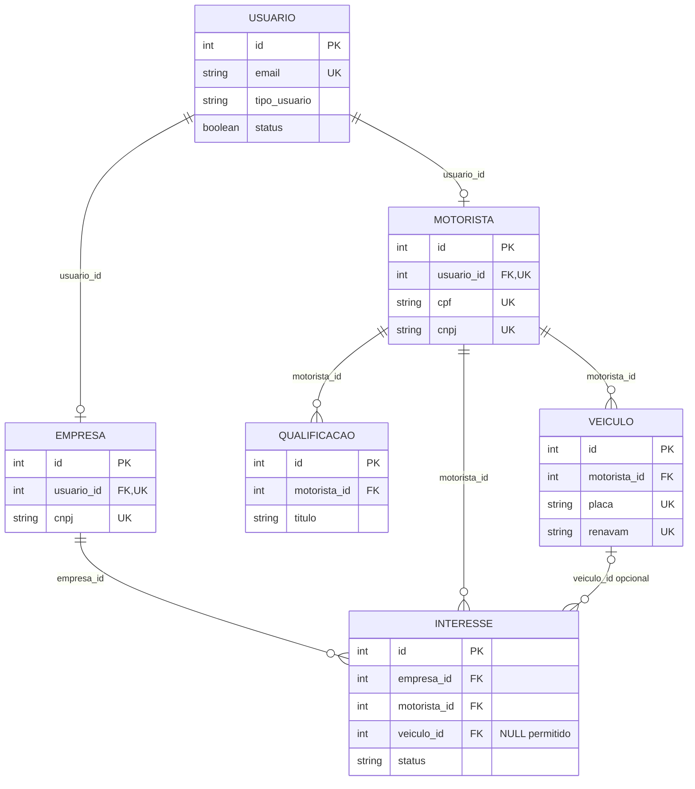

# Relacionamentos do banco de dados — BioCargo

Este documento descreve os relacionamentos declarados em [`01_schema.sql`](./01_schema.sql), em conjunto com as regras aprovadas registradas no projeto. As cardinalidades indicam o que o esquema permite; quando uma regra de negócio é mais restritiva, isso é identificado como responsabilidade do backend.

## 1. Visão geral dos relacionamentos

O banco possui seis tabelas:

| Tabela | Função |
|---|---|
| `usuario` | Guarda as credenciais, o tipo de usuário, o status e a data de cadastro. O tipo pode ser `EMPRESA`, `MOTORISTA` ou `ADMIN`. |
| `empresa` | Guarda os dados da empresa e referencia um usuário. |
| `motorista` | Guarda os dados do motorista PJ e referencia um usuário. |
| `qualificacao` | Guarda qualificações vinculadas a motoristas. |
| `veiculo` | Guarda veículos vinculados a motoristas. |
| `interesse` | Registra uma relação entre empresa e motorista e pode referenciar um veículo. |

As tabelas `empresa` e `motorista` se vinculam a `usuario`. Qualificações e veículos se vinculam a `motorista`. Cada interesse referencia uma empresa e um motorista, e pode também referenciar um veículo. O SQL declara chaves estrangeiras para esses vínculos.

## 2. Relacionamentos e cardinalidades

As cardinalidades abaixo descrevem as FKs e restrições existentes no SQL. A cardinalidade permitida pelo esquema pode ser mais ampla que uma regra de negócio validada pelo backend.

### `usuario` → `empresa`

- **Cardinalidade no SQL:** um usuário pode ter zero ou uma empresa; cada empresa deve estar associada a exatamente um usuário.
- **Chave estrangeira:** `empresa.usuario_id` → `usuario.id`, constraint `fk_empresa_usuario`.
- **Obrigatoriedade:** `empresa.usuario_id` é `NOT NULL`; do lado de `usuario`, não é obrigatório haver uma empresa.
- **Restrição adicional:** `empresa.usuario_id` é `UNIQUE`, limitando a um registro de empresa por usuário nesta tabela.
- **Explicação funcional:** representa os dados empresariais associados a uma conta. O SQL não verifica se o tipo dessa conta é `EMPRESA`.

### `usuario` → `motorista`

- **Cardinalidade no SQL:** um usuário pode ter zero ou um motorista; cada motorista deve estar associado a exatamente um usuário.
- **Chave estrangeira:** `motorista.usuario_id` → `usuario.id`, constraint `fk_motorista_usuario`.
- **Obrigatoriedade:** `motorista.usuario_id` é `NOT NULL`; do lado de `usuario`, não é obrigatório haver um motorista.
- **Restrição adicional:** `motorista.usuario_id` é `UNIQUE`, limitando a um registro de motorista por usuário nesta tabela.
- **Explicação funcional:** representa o perfil de motorista PJ associado a uma conta. O SQL não verifica se o tipo dessa conta é `MOTORISTA`, nem impede que o mesmo usuário tenha também registro em `empresa`.

### `motorista` → `qualificacao`

- **Cardinalidade:** um motorista pode ter zero ou várias qualificações; cada qualificação deve pertencer a exatamente um motorista.
- **Chave estrangeira:** `qualificacao.motorista_id` → `motorista.id`, constraint `fk_qualificacao_motorista`.
- **Obrigatoriedade:** `qualificacao.motorista_id` é `NOT NULL`; do lado de `motorista`, qualificações são opcionais.
- **Explicação funcional:** permite registrar várias qualificações para o mesmo motorista. Não há `UNIQUE` em `motorista_id` na tabela `qualificacao`.

### `motorista` → `veiculo`

- **Cardinalidade:** um motorista pode ter zero ou vários veículos; cada veículo deve pertencer a exatamente um motorista.
- **Chave estrangeira:** `veiculo.motorista_id` → `motorista.id`, constraint `fk_veiculo_motorista`.
- **Obrigatoriedade:** `veiculo.motorista_id` é `NOT NULL`; do lado de `motorista`, veículos são opcionais.
- **Explicação funcional:** permite que o motorista PJ cadastre vários veículos. Não há `UNIQUE` em `veiculo.motorista_id`.

### `empresa` → `interesse`

- **Cardinalidade:** uma empresa pode estar relacionada a zero ou vários interesses; cada interesse deve referenciar exatamente uma empresa.
- **Chave estrangeira:** `interesse.empresa_id` → `empresa.id`, constraint `fk_interesse_empresa`.
- **Obrigatoriedade:** `interesse.empresa_id` é `NOT NULL`; do lado de `empresa`, interesses são opcionais.
- **Explicação funcional:** identifica a empresa relacionada a cada interesse. O SQL não declara unicidade para a combinação empresa e motorista; portanto, não impede interesses repetidos para o mesmo par.

### `motorista` → `interesse`

- **Cardinalidade:** um motorista pode estar relacionado a zero ou vários interesses; cada interesse deve referenciar exatamente um motorista.
- **Chave estrangeira:** `interesse.motorista_id` → `motorista.id`, constraint `fk_interesse_motorista`.
- **Obrigatoriedade:** `interesse.motorista_id` é `NOT NULL`; do lado de `motorista`, interesses são opcionais.
- **Explicação funcional:** identifica o motorista relacionado a cada interesse. O SQL não declara unicidade para a combinação empresa e motorista.

### `veiculo` → `interesse`

- **Cardinalidade:** um veículo pode ser referenciado por zero ou vários interesses; cada interesse pode referenciar zero ou um veículo.
- **Chave estrangeira:** `interesse.veiculo_id` → `veiculo.id`, constraint `fk_interesse_veiculo`.
- **Obrigatoriedade:** `interesse.veiculo_id` é anulável (`INT NULL`); quando preenchido, deve referenciar um veículo existente. Do lado de `veiculo`, não é obrigatório haver interesses.
- **Explicação funcional:** permite associar opcionalmente um veículo ao interesse. O SQL verifica a existência do veículo, mas não que ele pertença ao motorista indicado no mesmo interesse.

## 3. Regras de negócio aprovadas

As regras a seguir são requisitos funcionais aprovados. Algumas estão parcialmente refletidas no SQL; as demais precisam ser aplicadas pela API/backend.

- O e-mail é único para cada usuário.
- O CNPJ deve ser único globalmente entre empresas e motoristas.
- Cada usuário pode possuir apenas um perfil entre `EMPRESA` e `MOTORISTA`; não poderá possuir os dois simultaneamente.
- `ADMIN` é um tipo de usuário, não uma tabela separada. Não existe perfil `PROPRIETÁRIO`.
- Um motorista pode cadastrar vários veículos.
- Um motorista pode possuir várias qualificações.
- Um interesse relaciona uma empresa a um motorista e pode indicar um veículo.
- O veículo indicado em um interesse deve pertencer ao motorista relacionado.
- Ao criar interesse com veículo, o veículo deve existir e estar disponível, além de pertencer ao motorista relacionado.
- A inativação de usuário será lógica, bloqueará o acesso e preservará registros e histórico.
- O fluxo normal da aplicação não deverá realizar exclusões físicas de usuários ou de registros históricos.

## 4. Regras garantidas pelo SQL atual

Esta seção lista as garantias efetivamente declaradas em `01_schema.sql`:

- **Chaves primárias:** todas as seis tabelas têm `id INT AUTO_INCREMENT PRIMARY KEY`.
- **Chaves estrangeiras:**
  - `empresa.usuario_id` → `usuario.id` (`fk_empresa_usuario`);
  - `motorista.usuario_id` → `usuario.id` (`fk_motorista_usuario`);
  - `qualificacao.motorista_id` → `motorista.id` (`fk_qualificacao_motorista`);
  - `veiculo.motorista_id` → `motorista.id` (`fk_veiculo_motorista`);
  - `interesse.empresa_id` → `empresa.id` (`fk_interesse_empresa`);
  - `interesse.motorista_id` → `motorista.id` (`fk_interesse_motorista`);
  - `interesse.veiculo_id` → `veiculo.id` (`fk_interesse_veiculo`).
- **Campos únicos:**
  - `usuario.email`;
  - `empresa.usuario_id` e `empresa.cnpj`;
  - `motorista.usuario_id`, `motorista.cpf` e `motorista.cnpj`;
  - `veiculo.placa` e `veiculo.renavam`.
- **Obrigatoriedade nas relações:** `empresa.usuario_id`, `motorista.usuario_id`, `qualificacao.motorista_id`, `veiculo.motorista_id`, `interesse.empresa_id` e `interesse.motorista_id` são `NOT NULL`. `interesse.veiculo_id` aceita `NULL`.
- **Valores enumerados:** `usuario.tipo_usuario` aceita `EMPRESA`, `MOTORISTA` e `ADMIN`; `interesse.status` aceita `PENDENTE`, `ACEITO` e `RECUSADO`.
- **Defaults relevantes:** `usuario.status` inicia com `TRUE`; `motorista.disponivel` e `veiculo.disponivel` iniciam com `FALSE`; `interesse.status` inicia com `PENDENTE`.

As FKs garantem que a referência apontada exista. As restrições `UNIQUE` se aplicam às colunas indicadas dentro de suas respectivas tabelas. O SQL não declara `ON DELETE CASCADE`.

## 5. Regras que dependem do backend

O SQL atual não garante os requisitos a seguir; a API deverá validá-los e aplicá-los:

- **Unicidade global do CNPJ:** `empresa.cnpj` e `motorista.cnpj` têm restrições `UNIQUE` separadas. Não há restrição cruzada entre as duas tabelas.
- **Exclusividade de perfil:** os `UNIQUE` independentes em `empresa.usuario_id` e `motorista.usuario_id` não impedem o mesmo usuário de aparecer nas duas tabelas.
- **Correspondência entre tipo e perfil:** as FKs não garantem `usuario.tipo_usuario = 'EMPRESA'` para uma empresa nem `usuario.tipo_usuario = 'MOTORISTA'` para um motorista. Também cabe ao backend impedir associação indevida de registros de perfil a usuários `ADMIN`.
- **Veículo associado ao interesse:** a FK confirma que o veículo existe, mas o SQL não valida que esteja disponível nem compara `veiculo.motorista_id` com `interesse.motorista_id`. O backend deve conferir existência, `veiculo.disponivel = TRUE` e propriedade em relação a `interesse.motorista_id` antes de criar o interesse.
- **Bloqueio de usuários inativos:** `usuario.status` armazena um valor booleano, mas o SQL não impede autenticação de usuários com status `FALSE`.
- **Preservação do histórico:** o SQL não estabelece uma política de exclusão lógica para todas as entidades nem impede que a aplicação tente excluir registros fisicamente. O fluxo da API deve inativar usuários, bloquear seu acesso e evitar exclusões físicas de usuários e dados históricos.

As verificações de unicidade global do CNPJ e exclusividade de perfil também precisam considerar requisições simultâneas: uma checagem apenas antes do `INSERT` pode permitir duplicidade concorrente, pois o esquema atual não possui uma restrição que as imponha entre tabelas.

## 6. Diagrama textual

O diagrama abaixo representa as seis tabelas, as colunas usadas nas relações e as cardinalidades permitidas pelas FKs e restrições do SQL. Ele não representa regras adicionais do backend como se fossem garantidas pelo banco.

**Limite do diagrama:** o SQL permite, estruturalmente, que um mesmo `usuario` tenha um registro em `empresa` e outro em `motorista`, apesar da regra aprovada proibir os dois perfis simultâneos. O diagrama também não expressa que o veículo de um interesse deve pertencer ao motorista do próprio interesse; essa validação é do backend.

## 7. Orientações para o Rafael

- No cadastro, validar a relação entre tipo de usuário e perfil e impedir que uma conta tenha simultaneamente perfil de empresa e de motorista.
- Validar o CNPJ globalmente nas tabelas `empresa` e `motorista`; considerar concorrência, pois o SQL atual não impõe essa unicidade cruzada.
- Ao criar interesse com `veiculo_id`, confirmar que o veículo existe, está disponível e pertence ao `motorista_id` informado.
- No login e na validação de sessão, recusar usuários com `usuario.status = FALSE`.
- Implementar inativação lógica e não expor exclusões físicas de usuários ou registros que precisem permanecer no histórico.
- Respeitar as FKs e os `UNIQUE` existentes, tratando violações do banco como respostas de erro apropriadas.
- Aplicar autorização por perfil e propriedade em todas as operações; a existência de uma FK não autoriza um usuário a acessar o registro relacionado.
