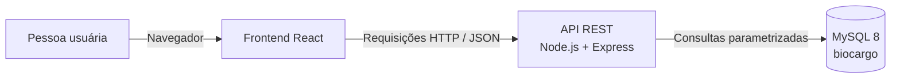
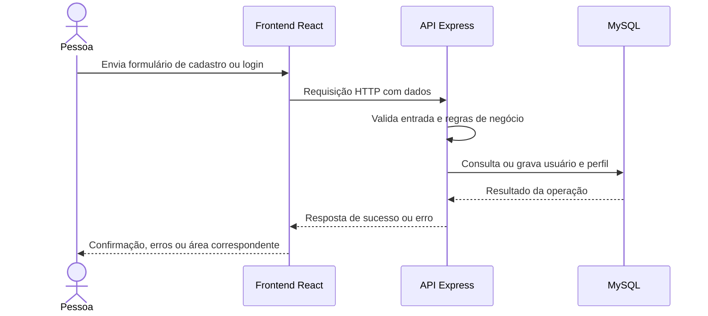

# Arquitetura geral — BioCargo

Este documento registra a arquitetura atual do frontend e a arquitetura planejada para a API e sua integração com o banco. **“Existente”** identifica o que já está no repositório; **“Planejado”** identifica componentes e fluxos que ainda precisam ser implementados ou definidos.

## 1. Visão geral da arquitetura

O BioCargo será uma aplicação web com frontend React, uma API REST em Node.js e Express e um banco MySQL 8. Para o escopo do MVP, a proposta é manter frontend, API e persistência como partes de uma aplicação única organizada por responsabilidades, sem adotar microserviços.

**Existente:** a aplicação React oferece a landing page, o login visual e formulários de cadastro de empresa e motorista PJ. Os formulários ainda não enviam dados ao backend. A pasta `backend/` está vazia.

**Planejado:** Rafael implementará a API, autenticação e integração com MySQL. O frontend passará a consumir a API por serviços HTTP. O navegador não acessará o banco diretamente.



## 2. Tecnologias utilizadas e responsabilidades

| Tecnologia | Estado | Responsabilidade |
|---|---|---|
| React e JavaScript | Existente | Construir a interface e os componentes do frontend. |
| Vite | Existente | Servir o frontend durante o desenvolvimento e gerar o build. |
| React Router DOM | Existente | Organizar as rotas de página no frontend. |
| CSS puro | Existente | Definir estilos e responsividade. |
| Node.js e JavaScript | Planejado | Executar o backend. |
| Express | Planejado | Compor a API HTTP e organizar middlewares e rotas. |
| MySQL 8 | Banco existente | Persistir usuários, empresas, motoristas, qualificações, veículos e interesses. |
| API REST | Planejado | Contrato de comunicação entre frontend e backend. |

O frontend declara React, React DOM, React Router DOM, Vite e Oxlint em `frontend/package.json`. Não há dependências ou estrutura de backend no repositório. A biblioteca de acesso a dados, o mecanismo de sessão e as demais dependências do backend ainda não foram definidos.

## 3. Comunicação entre frontend, backend e banco

O frontend enviará requisições HTTP à API Express. A API validará os dados, aplicará regras de negócio e fará operações no MySQL. A API será responsável por retornar ao frontend respostas apropriadas e não expor detalhes internos do banco.

Fluxo de comunicação planejado:

1. A página coleta os dados e chama um serviço HTTP do frontend.
2. O serviço envia a requisição à rota correspondente da API.
3. A rota encaminha a requisição ao controlador e aos serviços de negócio.
4. O backend valida autorização e dados, executa as regras e solicita operações ao acesso a dados.
5. O acesso a dados consulta ou atualiza o MySQL.
6. A API responde em formato acordado; o frontend apresenta o resultado ou erros nos campos/formulário.

O contrato de payloads, códigos de erro, paginação, prefixo de versão e estratégia de credenciais ainda precisa ser fechado. Os formulários atuais exibem uma mensagem de integração pendente e deixam claro que nenhum dado é enviado.

## 4. Responsabilidades por camada

### Apresentação — frontend

**Existente:** páginas e componentes React, rotas públicas, estilos CSS e validações locais de CPF, CNPJ e confirmação de senha.

**Planejado:** serviços HTTP para consumir a API, estado de sessão, tratamento de respostas e erros do servidor e proteção de rotas da interface por perfil. As restrições visuais no frontend não substituem autenticação, autorização ou validação no backend.

### Rotas e controladores — backend

**Planejado:** as rotas Express definem caminhos HTTP, métodos e middlewares; os controladores recebem a requisição, delegam o processamento e formatam a resposta. Devem manter SQL e regras de negócio fora dos controladores.

### Serviços e regras de negócio — backend

**Planejado:** os serviços implementam os fluxos do MVP e validam regras como correspondência entre perfil e usuário, propriedade de registros, relação entre veículo e motorista em interesses, status de usuário e transições permitidas. Também coordenam operações que envolvem mais de um registro.

### Acesso a dados e MySQL — backend

**Planejado:** uma camada de acesso a dados concentra consultas ao MySQL e o mapeamento de resultados. As consultas devem usar parâmetros, respeitar as FKs e restrições `UNIQUE` existentes e usar transações quando um fluxo depender de gravações relacionadas, como a criação do usuário junto ao perfil. A tecnologia ou biblioteca de acesso ainda não foi selecionada.

### Middlewares e configuração — backend

**Planejado:** middlewares para autenticação, autorização, validação e tratamento centralizado de erros. A configuração de ambiente deve manter credenciais e segredos fora do código. A política de CORS será definida de acordo com as origens de desenvolvimento e publicação.

## 5. Fluxo de cadastro e autenticação

### Cadastro

**Existente:** há formulários separados para Empresa e Motorista PJ. O formulário de empresa coleta razão social, nome fantasia, CNPJ, telefone, e-mail e senha; o de motorista coleta nome, CPF, CNPJ, telefone, e-mail e senha. Ambos conferem a confirmação da senha e exibem validações locais. Ainda não há envio ao backend.

**Planejado:**

1. A pessoa escolhe o tipo de cadastro na página `/cadastro`.
2. O frontend valida a entrada para orientar a pessoa e envia os dados do perfil escolhido à API.
3. O backend valida novamente os dados, verifica duplicidades e aplica as regras de negócio.
4. O backend cria o usuário e o registro correspondente em `empresa` ou `motorista`, mantendo a consistência da operação.
5. A API retorna o resultado conforme o contrato a definir.

O tipo de usuário deve ser definido pelo fluxo validado no servidor; o backend não deve aceitar que um cadastro público escolha `ADMIN`. A estratégia de senha segura e o início de sessão após o cadastro ainda precisam ser definidos.

### Autenticação

**Existente:** `/login` contém campos de e-mail e senha, mas não realiza autenticação.

**Planejado:** cadastro e login normalizam e-mail removendo espaços externos e usando comparação sem distinção entre maiúsculas e minúsculas. A API validará a senha conforme o mecanismo escolhido e recusará acesso quando `usuario.status` indicar inatividade. A inativação administrativa definirá `status = FALSE` e invalidará as sessões ativas; a estratégia de sessão e o mecanismo de revogação ainda serão implementados. O frontend usará a identidade e o tipo de usuário retornados para direcionar a pessoa à área correspondente, que ainda não foi implementada.



O diagrama descreve o fluxo planejado, não uma integração já funcional.

## 6. Fluxo de busca de motoristas e veículos

**Planejado para o MVP:** uma empresa autenticada solicita a busca pela API. Por padrão, o backend retorna somente motoristas com conta ativa (`usuario.status = TRUE`) e disponibilidade habilitada (`motorista.disponivel = TRUE`); filtros adicionais restringem esse conjunto. `veiculo.disponivel` é um estado separado aplicado aos veículos. O backend valida o perfil e os parâmetros, consulta motoristas e, quando aplicável, seus veículos, e retorna somente os dados definidos para apresentação. A busca e os filtros ainda não foram implementados.

O esquema atual relaciona veículos a motoristas por `veiculo.motorista_id`. O backend deve manter essa relação e não permitir que a consulta exponha dados que não façam parte do resultado autorizado. Não estão definidos aqui filtros específicos, ordenação ou campos públicos além do que consta no esquema.

## 7. Fluxo de demonstração de interesse

**Planejado para o MVP:** a empresa autenticada escolhe um motorista e pode, opcionalmente, informar um veículo. A API identifica a empresa exclusivamente pela sessão autenticada, recebe `motoristaId` como alvo e `veiculoId` como alvo opcional, e valida que o veículo existe, está disponível e pertence ao motorista indicado antes de criar o registro em `interesse`. O banco define `PENDENTE` como status padrão quando o valor não é informado.

O SQL relaciona `interesse` com empresa e motorista por FKs e permite `veiculo_id` nulo. Ele não verifica a propriedade do veículo em relação ao motorista indicado, não impede interesses repetidos para o mesmo par e não define quais perfis podem alterar cada status. Essas regras e permissões precisam ser formalizadas e validadas no backend.

## 8. Estrutura de pastas

### Estrutura existente relevante

```text
BioCargo/
├── README.md                     # existente, atualmente vazio
├── backend/                      # existente, vazio
├── database/
│   ├── 01_schema.sql             # existente
│   ├── 02_dicionario_dados.md    # existente
│   └── 03_relacionamentos.md     # existente
├── docs/
│   ├── 04_arquitetura_geral.md  # existente
│   └── 05_contrato_api_endpoints.md # existente; contrato planejado da API
└── frontend/
    ├── package.json
    ├── vite.config.js
    └── src/
        ├── components/
        ├── pages/
        ├── routes/
        ├── styles/
        └── utils/
```

### Organização planejada

Esta é uma proposta para organizar os arquivos futuros; não representa arquivos já implementados.

```text
BioCargo/
├── backend/
│   ├── src/
│   │   ├── config/          # ambiente e conexão MySQL
│   │   ├── routes/          # caminhos REST
│   │   ├── controllers/     # entrada HTTP e respostas
│   │   ├── services/        # regras e fluxos de negócio
│   │   ├── repositories/    # consultas e persistência
│   │   ├── middlewares/     # autenticação, autorização, validação e erros
│   │   ├── validations/     # regras de entrada
│   │   └── app.js           # configuração da aplicação Express
│   └── server.js            # inicialização do servidor
├── database/
│   ├── 01_schema.sql
│   ├── 02_dicionario_dados.md
│   └── 03_relacionamentos.md
├── docs/
│   ├── 04_arquitetura_geral.md
│   └── 05_contrato_api_endpoints.md
└── frontend/
    └── src/
        ├── components/
        ├── context/         # estado de sessão, se essa abordagem for adotada
        ├── pages/
        ├── routes/
        ├── services/        # cliente HTTP e chamadas por módulo
        ├── styles/
        └── utils/
```

O detalhamento das subpastas deve acompanhar os módulos efetivamente implementados. A proposta não exige criar todas as pastas de uma vez.

## 9. Padrões de organização e comunicação entre camadas

- Manter a comunicação do frontend com o backend pela API HTTP; nenhuma página ou componente deve consultar o MySQL diretamente.
- Agrupar chamadas do frontend em serviços por domínio, evitando chamadas HTTP espalhadas pelos componentes.
- Manter rotas responsáveis por mapear URL e middleware, controladores por tratar o protocolo HTTP e serviços por regras de negócio.
- Concentrar consultas SQL na camada de acesso a dados; utilizar parâmetros nas consultas.
- Validar dados tanto no frontend, para usabilidade, quanto no backend, como limite confiável de entrada.
- Aplicar autenticação e autorização na API em cada operação protegida, sem confiar apenas em rotas ocultas no frontend.
- Centralizar o formato de respostas e erros após definir o contrato da API.
- Usar transações em operações que criem ou atualizem registros relacionados e precisem manter consistência.
- Preservar o histórico: inativar usuários logicamente, bloquear acesso de contas inativas e não realizar exclusões físicas no fluxo normal da aplicação.
- Não tratar regra de negócio como restrição do banco quando ela não estiver expressa em `01_schema.sql`.

## 10. Responsabilidades de Samy e Rafael

Conforme a divisão de trabalho informada para esta etapa:

| Responsável | Escopo |
|---|---|
| Samy | Preparação da base do projeto, frontend e documentação técnica. O frontend público e a documentação do banco já existem parcialmente. |
| Rafael | Implementação do backend, APIs, autenticação e integração com o frontend e o MySQL. |

Contratos de API, decisões pendentes e validações de regras que não estão garantidas pelo SQL devem ser alinhados entre as partes antes de integrar os fluxos.

## 11. Decisões técnicas já tomadas

- O projeto será uma aplicação web com frontend React e backend Node.js/Express em JavaScript.
- O frontend utiliza Vite, React Router DOM e CSS puro.
- O banco é MySQL 8 e seu esquema atual está registrado em `database/01_schema.sql`.
- O frontend e o backend se comunicarão por API REST.
- O escopo é um MVP em arquitetura única; não serão adotados microserviços.
- Os tipos de usuário são `EMPRESA`, `MOTORISTA` e `ADMIN`; `ADMIN` não possui tabela própria e não existe perfil `PROPRIETÁRIO`.
- O CNPJ deve ser único globalmente entre as tabelas `empresa` e `motorista`.
- Cada usuário poderá possuir somente um perfil: `EMPRESA` ou `MOTORISTA`, nunca os dois simultaneamente.
- A inativação de usuários deve ser lógica, bloquear acesso e preservar o histórico. O fluxo normal não deve excluir fisicamente usuários ou registros históricos.
- A inativação será executada por um `ADMIN` autorizado por meio de endpoint administrativo planejado; deverá definir `usuario.status = FALSE`, bloquear acesso e invalidar sessões ativas. O endpoint e o backend ainda não estão implementados.
- E-mails serão normalizados removendo espaços externos e convertendo para minúsculas; cadastro, login e validação de unicidade usarão essa mesma forma canônica.
- Datas e horários da API serão retornados em ISO 8601 UTC; o frontend fará a conversão para o horário local na apresentação. Como `DATETIME` não guarda fuso, o backend deverá configurar a conexão MySQL em UTC ou fazer conversões explícitas, sem alteração do esquema nesta etapa.
- As páginas de login e cadastro existem no frontend, mas ainda não estão integradas.

## 12. Pontos pendentes de definição

Antes ou durante a implementação, Samy e Rafael precisam definir:

- A biblioteca de acesso ao MySQL e como as transações serão executadas.
- O contrato REST: prefixo/versionamento, endpoints, formatos de requisição/resposta, erros e paginação.
- O mecanismo de autenticação e sessão, incluindo token/cookie, expiração, renovação, armazenamento, logout e a implementação técnica da invalidação obrigatória após inativação.
- O algoritmo e os parâmetros de hash de senha, além de requisitos de senha.
- O procedimento para criar a primeira conta `ADMIN`, além de regras de auto-inativação e proteção do último administrador.
- A regra de CNPJ global já foi aprovada; falta definir como garantir sua integridade no backend diante de requisições simultâneas, pois as restrições atuais são separadas entre `empresa` e `motorista`.
- A exclusividade entre perfis já foi aprovada; falta definir como garantir tecnicamente essa regra no backend, já que o SQL atual permite estruturalmente que o mesmo usuário apareça nas duas tabelas.
- Os campos e critérios de busca de motoristas e veículos, além dos dados que podem ser exibidos.
- Quem pode criar, consultar, aceitar ou recusar interesses e quais transições de status são permitidas.
- Se interesses repetidos para a mesma empresa e motorista serão permitidos ou bloqueados pela aplicação.
- As origens de CORS por ambiente, variáveis necessárias, endereços de desenvolvimento e estratégia de implantação.
- A configuração técnica da conexão MySQL em UTC, ou das conversões equivalentes, para que o `DATETIME` sem fuso seja interpretado e persistido como UTC.
- As páginas e rotas autenticadas que formarão as áreas de empresa, motorista e administração após a integração.

Até que esses pontos sejam definidos, os fluxos e a estrutura apresentados como planejados servem como base de alinhamento, não como comportamento já implementado.
