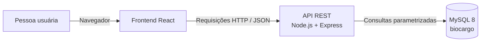
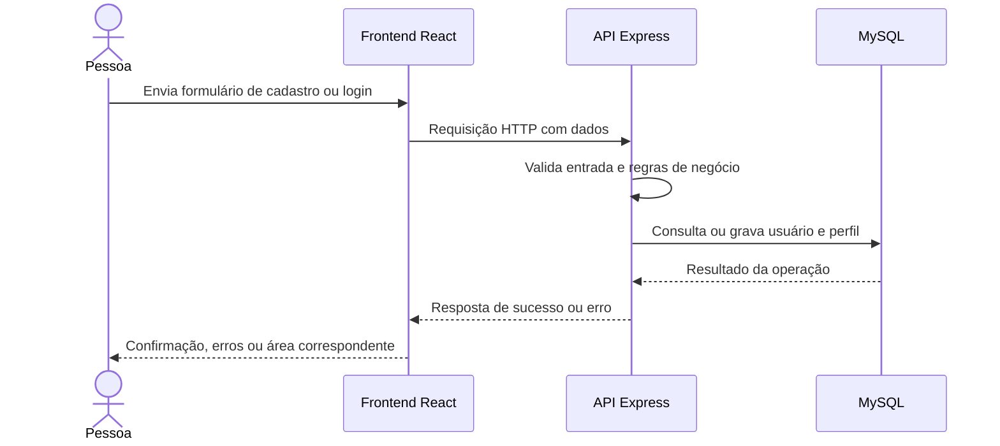

# Arquitetura geral — BioCargo

Este documento registra a arquitetura do BioCargo atualizada em 16/11/2026. O estado de cada endpoint e seu contrato de payloads estão detalhados em [`05_contrato_api_endpoints.md`](./05_contrato_api_endpoints.md); áreas React autenticadas ainda não fazem parte do frontend atual.

## 1. Visão geral da arquitetura

O BioCargo é uma aplicação web com frontend React, uma API REST em Node.js e Express e um banco MySQL 8. O MVP mantém frontend, API e persistência como partes de uma aplicação única, sem microserviços.

**Existente:** o frontend oferece landing page, login e cadastros de empresa e motorista PJ integrados à API. O backend implementa cadastro, login, sessão MySQL, perfis próprios, veículos, qualificações, pesquisa, interesses e inativação administrativa.

**Arquitetura:** o frontend consome a API REST; somente o backend acessa o MySQL. As próximas telas autenticadas do frontend ainda precisam ser integradas.



## 2. Tecnologias utilizadas e responsabilidades

| Tecnologia | Estado | Responsabilidade |
|---|---|---|
| React e JavaScript | Existente | Construir a interface e os componentes do frontend. |
| Vite | Existente | Servir o frontend durante o desenvolvimento e gerar o build. |
| React Router DOM | Existente | Organizar as rotas de página no frontend. |
| CSS puro | Existente | Definir estilos e responsividade. |
| Node.js e JavaScript | Existente | Executar o backend. |
| Express | Existente | Compor a API HTTP e organizar middlewares e rotas. |
| MySQL 8 | Banco existente | Persistir usuários, empresas, motoristas, qualificações, veículos e interesses. |
| API REST | Parcialmente existente | API JSON sob `/api/v1`; ver contrato para endpoints implementados e pendências. |

O frontend declara React, React DOM, React Router DOM, Vite e Oxlint em `frontend/package.json`. O backend declara Express, `mysql2/promise`, `express-session` e `express-mysql-session` em `backend/package.json`.

## 3. Comunicação entre frontend, backend e banco

O frontend envia requisições HTTP à API Express. A API valida dados e permissões, aplica regras de negócio e opera no MySQL. A API retorna respostas apropriadas sem expor detalhes internos do banco.

Fluxo de comunicação:

1. A página coleta os dados e chama um serviço HTTP do frontend.
2. O serviço envia a requisição à rota correspondente da API.
3. A rota encaminha a requisição ao controlador e aos serviços de negócio.
4. O backend valida autorização e dados, executa as regras e solicita operações ao acesso a dados.
5. O acesso a dados consulta ou atualiza o MySQL.
6. A API responde em formato acordado; o frontend apresenta o resultado ou erros nos campos/formulário.

O contrato atual de payloads, status, paginação e autenticação está em `docs/05_contrato_api_endpoints.md`. O proxy Vite encaminha `/api` para o backend durante o desenvolvimento.

## 4. Responsabilidades por camada

### Apresentação — frontend

**Existente:** páginas e componentes React, rotas públicas, estilos CSS e validações locais de CPF, CNPJ e confirmação de senha.

**Parcialmente existente:** serviços HTTP integram cadastro e login. Estado de sessão, telas de perfil e demais áreas autenticadas ainda precisam ser integrados. As restrições visuais no frontend não substituem autenticação, autorização ou validação no backend.

### Rotas e controladores — backend

**Existente:** Express define as rotas; middlewares revalidam sessão, conta ativa e perfil. Módulos de perfil, veículos, qualificações, pesquisa, interesses e administração estão em `backend/src/routes/`; autenticação e cadastro permanecem em `server.js`.

### Serviços e regras de negócio — backend

**Existente:** os módulos de rota aplicam as regras do contrato, inclusive propriedade, disponibilidade e transições de interesse. Fluxos relacionados usam transações MySQL quando necessário.

### Acesso a dados e MySQL — backend

**Existente:** `mysql2/promise` fornece o pool e consultas parametrizadas. Cadastro e criação de interesse usam transações; as operações respeitam FKs e `UNIQUE` disponíveis no schema. Regras globais de CNPJ e exclusividade de perfil ainda não têm garantia concorrente no schema.

### Middlewares e configuração — backend

**Existente:** middleware de autenticação e autorização por perfil valida cada sessão contra `usuario`. Segredo de sessão é obrigatório; cookie de sessão usa `httpOnly`, `sameSite=lax` e `secure` em produção. CORS aceita somente origens explícitas em `CORS_ORIGINS`; sem configuração, use same-origin/Vite proxy.

## 5. Fluxo de cadastro e autenticação

### Cadastro

**Existente:** há formulários separados para Empresa e Motorista PJ. O formulário de empresa coleta razão social, nome fantasia, CNPJ, telefone, e-mail e senha; o de motorista coleta nome, CPF, CNPJ, telefone, e-mail e senha. Ambos validam localmente e enviam cadastro à API.

**Implementado no backend:**

1. A pessoa escolhe o tipo de cadastro na página `/cadastro`.
2. O frontend valida a entrada para orientar a pessoa e envia os dados do perfil escolhido à API.
3. O backend valida novamente os dados, verifica duplicidades e aplica as regras de negócio.
4. O backend cria o usuário e o registro correspondente em `empresa` ou `motorista`, mantendo a consistência da operação.
5. A API retorna o resultado conforme `docs/05_contrato_api_endpoints.md`.

O tipo de usuário é definido pelo endpoint do servidor; cadastro público não pode escolher `ADMIN`. Senhas usam `scrypt`; cadastro não inicia uma sessão automaticamente.

### Autenticação

**Existente:** `/login` autentica por meio da API e recebe uma sessão HTTP armazenada no MySQL.

**Implementado no backend:** e-mails são normalizados; login recusa contas inativas; rotas protegidas revalidam status e perfil. A operação administrativa inativa a conta e remove suas sessões. O frontend ainda não tem estado de sessão nem áreas autenticadas.



O diagrama resume o fluxo de cadastro e autenticação atualmente integrado.

## 6. Fluxo de busca de motoristas e veículos

**Implementado:** empresa autenticada pesquisa motoristas ativos e disponíveis com filtros de disponibilidade do veículo, marca, modelo, ano e título de qualificação. Os resultados minimizam dados pessoais e incluem veículos ativos. Localização não existe no schema.

O esquema atual relaciona veículos a motoristas por `veiculo.motorista_id`. O backend deve manter essa relação e não permitir que a consulta exponha dados que não façam parte do resultado autorizado. Não estão definidos aqui filtros específicos, ordenação ou campos públicos além do que consta no esquema.

## 7. Fluxo de demonstração de interesse

**Implementado:** empresa autenticada cria e consulta interesses; motorista consulta, aceita/recusa e cancela após aceite com justificativa. A API deriva a empresa da sessão e valida disponibilidade, propriedade do veículo e transições permitidas.

O SQL relaciona `interesse` a empresa, motorista e veículo por FKs e permite `veiculo_id` nulo. Regras de propriedade, duplicidade de estados ativos e transições são aplicadas pelo backend.

## 8. Estrutura de pastas

### Estrutura existente relevante

```text
BioCargo/
├── README.md                     # instruções e status atual
├── backend/
│   ├── package.json
│   ├── src/
│   │   ├── config/database.js
│   │   ├── middleware/authorization.js
│   │   ├── routes/               # perfis, veículos, qualificações, busca, interesses, admin
│   │   └── server.js             # autenticação e inicialização Express
│   └── test/                     # testes HTTP com pool MySQL simulado
├── database/
│   ├── 01_schema.sql             # existente
│   ├── 02_dicionario_dados.md    # existente
│   └── 03_relacionamentos.md     # existente
├── docs/
│   ├── 04_arquitetura_geral.md  # existente
│   ├── 05_contrato_api_endpoints.md # contrato e status dos endpoints
│   └── 06_handoff_backend_rafael.md
└── frontend/
    ├── package.json
    ├── vite.config.js
    └── src/
        ├── components/
        ├── pages/
        ├── routes/
        ├── styles/
        └── utils/
```

### Evolução possível da organização

Controladores e serviços separados podem ser introduzidos conforme os módulos cresçam; não são necessários para as rotas atuais.

```text
BioCargo/
├── backend/
│   ├── src/
│   │   ├── config/          # ambiente e conexão MySQL
│   │   ├── routes/          # caminhos REST
│   │   ├── controllers/     # entrada HTTP e respostas
│   │   ├── services/        # regras e fluxos de negócio
│   │   ├── repositories/    # consultas e persistência
│   │   ├── middlewares/     # autenticação, autorização, validação e erros
│   │   ├── validations/     # regras de entrada
│   │   └── app.js           # configuração da aplicação Express
│   └── server.js            # inicialização do servidor
├── database/
│   ├── 01_schema.sql
│   ├── 02_dicionario_dados.md
│   └── 03_relacionamentos.md
├── docs/
│   ├── 04_arquitetura_geral.md
│   └── 05_contrato_api_endpoints.md
└── frontend/
    └── src/
        ├── components/
        ├── context/         # estado de sessão, se essa abordagem for adotada
        ├── pages/
        ├── routes/
        ├── services/        # cliente HTTP e chamadas por módulo
        ├── styles/
        └── utils/
```

O detalhamento das subpastas deve acompanhar os módulos efetivamente implementados. A proposta não exige criar todas as pastas de uma vez.

## 9. Padrões de organização e comunicação entre camadas

- Manter a comunicação do frontend com o backend pela API HTTP; nenhuma página ou componente deve consultar o MySQL diretamente.
- Agrupar chamadas do frontend em serviços por domínio à medida que as telas autenticadas forem integradas.
- As rotas atuais validam entrada, executam regras de domínio e consultas parametrizadas; separar controladores/serviços/repositórios é uma evolução possível.
- Validar dados tanto no frontend, para usabilidade, quanto no backend, como limite confiável de entrada.
- Aplicar autenticação e autorização na API em cada operação protegida, sem confiar apenas em rotas ocultas no frontend.
- Seguir o contrato atual para respostas; handlers devolvem mensagens de erro genéricas sem stack trace ou SQL.
- Usar transações em operações que criem ou atualizem registros relacionados e precisem manter consistência.
- Preservar o histórico: inativar usuários logicamente, bloquear acesso de contas inativas e não realizar exclusões físicas no fluxo normal da aplicação.
- Não tratar regra de negócio como restrição do banco quando ela não estiver expressa em `01_schema.sql`.

## 10. Responsabilidades de Samy e Rafael

Conforme a divisão de trabalho informada para esta etapa:

| Responsável | Escopo |
|---|---|
| Samy | Preparação da base do projeto, frontend e documentação técnica. O frontend público e a documentação do banco já existem parcialmente. |
| Rafael | Implementação do backend, APIs, autenticação e integração com o frontend e o MySQL. |

Contratos de API, decisões pendentes e validações de regras que não estão garantidas pelo SQL devem ser alinhados entre as partes antes de integrar os fluxos.

## 11. Decisões técnicas já tomadas

- O projeto será uma aplicação web com frontend React e backend Node.js/Express em JavaScript.
- O frontend utiliza Vite, React Router DOM e CSS puro.
- O banco é MySQL 8 e seu esquema atual está registrado em `database/01_schema.sql`.
- O frontend e o backend se comunicarão por API REST.
- O escopo é um MVP em arquitetura única; não serão adotados microserviços.
- Os tipos de usuário são `EMPRESA`, `MOTORISTA` e `ADMIN`; `ADMIN` não possui tabela própria e não existe perfil `PROPRIETÁRIO`.
- O CNPJ deve ser único globalmente entre as tabelas `empresa` e `motorista`.
- Cada usuário poderá possuir somente um perfil: `EMPRESA` ou `MOTORISTA`, nunca os dois simultaneamente.
- A inativação de usuários deve ser lógica, bloquear acesso e preservar o histórico. O fluxo normal não deve excluir fisicamente usuários ou registros históricos.
- A inativação é executada por um `ADMIN` ativo no endpoint administrativo; define `usuario.status = FALSE`, remove sessões ativas e preserva o histórico.
- E-mails serão normalizados removendo espaços externos e convertendo para minúsculas; cadastro, login e validação de unicidade usarão essa mesma forma canônica.
- Datas e horários da API serão retornados em ISO 8601 UTC; o frontend fará a conversão para o horário local na apresentação. Como `DATETIME` não guarda fuso, o backend deverá configurar a conexão MySQL em UTC ou fazer conversões explícitas, sem alteração do esquema nesta etapa.
- Cadastro e login existentes no frontend estão integrados; as áreas autenticadas ainda não foram criadas.

## 12. Pontos pendentes de definição

Antes ou durante a implementação, Samy e Rafael precisam definir:

- O procedimento seguro para provisionar a primeira conta `ADMIN`.
- Regras técnicas para garantir CNPJ globalmente único e perfil exclusivo sob concorrência; o schema atual só garante unicidade dentro de cada tabela.
- Revisar collation e valores de e-mail existentes para alinhar a restrição `UNIQUE` à normalização da API.
- Renovação de sessão além das 24 horas; cookie seguro em produção e revogação por inativação já estão implementados.
- Aprovação de produto para exibir nome do motorista na pesquisa; atualmente a resposta o omite.
- Alteração de e-mail/documentos em perfis não está incluída nas rotas atuais.
- Definir a política de conexão/conversão UTC para todos os campos `DATETIME`; interesses já usam `UTC_TIMESTAMP()` e retornam ISO UTC.
- Origens cross-site exigem política adicional de cookie/CSRF; same-origin/proxy Vite e CORS de origens exatas do mesmo site estão configurados.
Os endpoints implementados e regras de transição atuais estão descritos em `docs/05_contrato_api_endpoints.md`. Os itens acima continuam pendentes; as telas autenticadas do frontend também precisam ser alinhadas e construídas.
